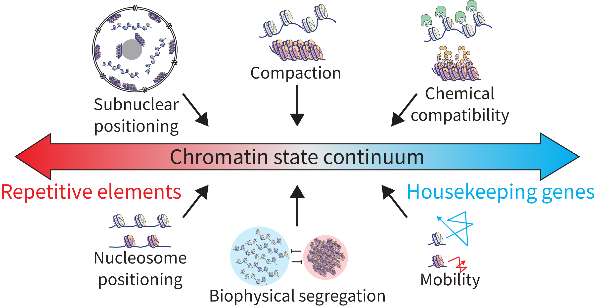

Our main question is to understand how different chromatin states ensure robust gene expression programs. We challenge the classical view of chromatin as discrete nuclear compartments defined by histone modifications and reader proteins, imagining instead a continuum shaped by multiple parameters. This raises key questions: what molecular mechanisms define these parameters, how do they interact to control transcription, and how do dynamic chromatin states influence developmental gene expression programs? 

{width="1000"}

We use *C. elegans* larval development as a model system to address specific questions about developmental gene expression programs.

**Why do heterochromatin domains remain dynamic in post-mitotic tissues?**
We previously found that H3K9 methylated histone modifications and transcription silencing remain in a dynamic equilibrium in differentiated cells. [Methot SP, Padeken J et al., 2021](https://doi.org/10.1038/s41556-021-00776-w)

We are exploring physiological contexts in which heterochromatin is under dynamic control in animals, and how these dynamics are regulated.

**How is dynamic chromatin accessbility regulated and what is its role in regulating dynamic transcription?**

[Gaidatzis D^1,2^, Graf-Landua M^1^, Methot SP^1^, Woelk M, Brancati G, Hauser YP, Meeuse M,  Nahar S, Braun K, van der Does M, Aluri S, Kohler H, Smallwood S, Grosshans H^2^. A scheduler for rhythmic gene expression. bioRxiv. September, 2025. ^1^equal contribution ^2^co-corresponding](https://doi.org/10.1101/2025.09.04.674194)
